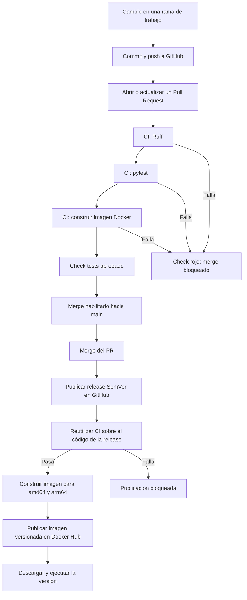
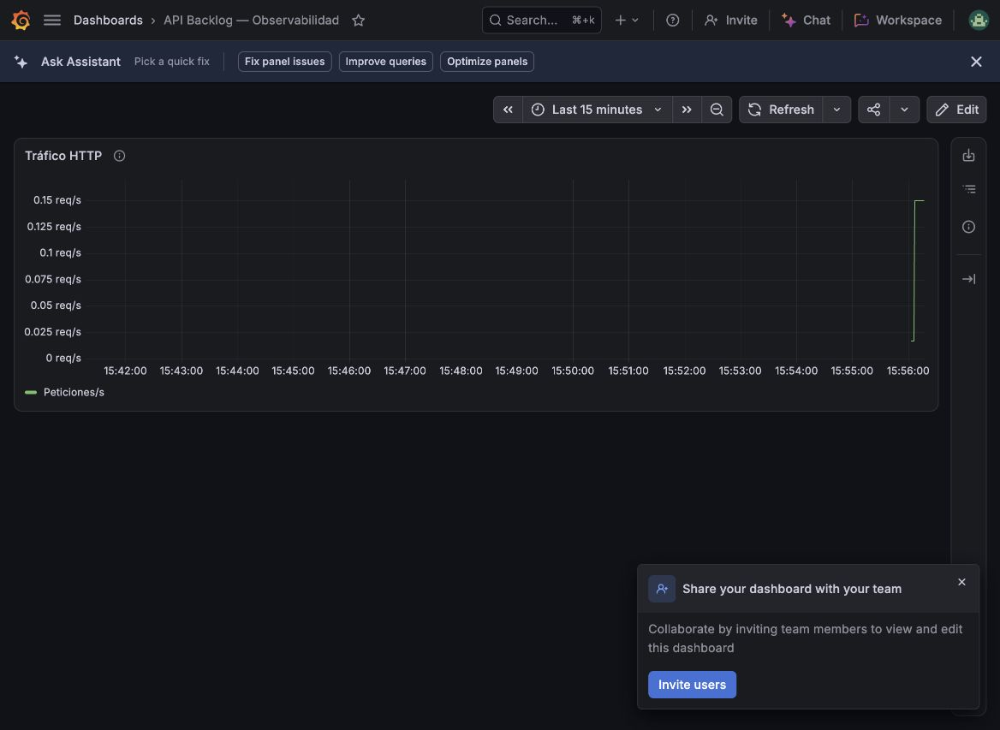
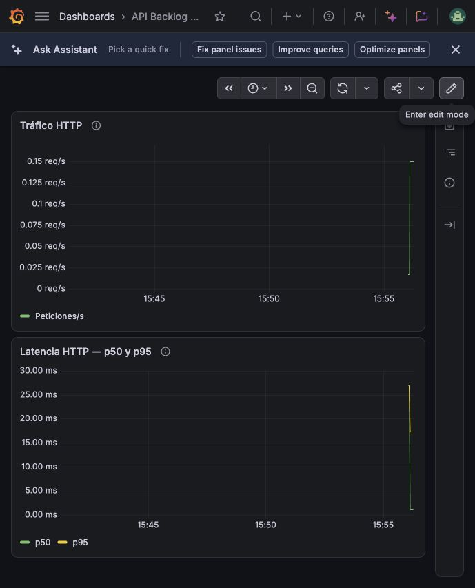
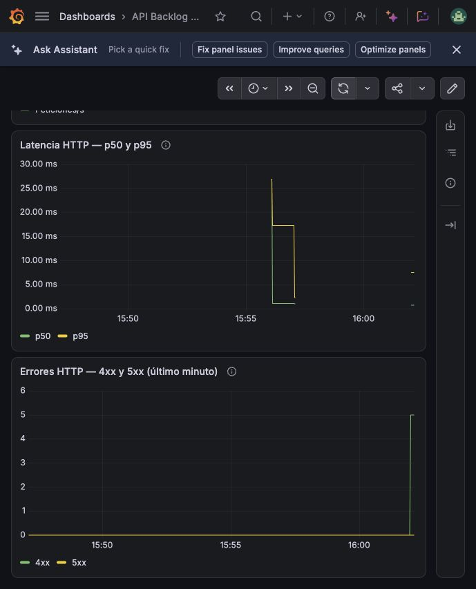
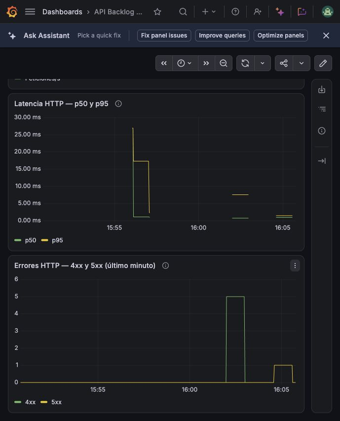

# Informe técnico — API Backlog de Videojuegos

## 1. Descripción y alcance

El proyecto implementa una API REST para administrar un backlog de
videojuegos mediante FastAPI y SQLite.

Permite registrar juegos, consultarlos, filtrar por estado, actualizar
su estado y eliminarlos. Incluye validaciones de datos, control de
duplicados y documentación interactiva mediante Swagger en `/docs`.

El foco del trabajo es aplicar prácticas DevOps al ciclo de vida de
la aplicación: gestión de cambios mediante Pull Requests, validaciones
automatizadas, empaquetado reproducible, publicación de imágenes
versionadas y observabilidad.

La API puede ejecutarse localmente con Python 3.13, mediante Docker
Compose o descargando una imagen publicada en Docker Hub.

El despliegue automático a una plataforma de hosting mediante Deploy
Hook no forma parte de la implementación actual.

## 2. Arquitectura del pipeline

El flujo separa la integración de cambios de la publicación de versiones.

La publicación de la release es una acción manual. Desde ese evento,
la validación, construcción y publicación de la imagen son automáticas.

La protección de `main` exige un Pull Request y la aprobación del
check `tests`. Este check incluye el linter, las pruebas y la
construcción de Docker. No hay actores configurados para omitir
estas reglas.

El workflow de releases reutiliza el workflow de CI mediante
`workflow_call`. El job de publicación declara `needs: validar`,
por lo que solo se ejecuta después de que las validaciones finalicen
correctamente.

### Componentes del flujo

| Componente | Herramienta y responsabilidad |
|---|---|
| Control de versiones | Git y repositorio público en GitHub |
| Gestión de cambios | Ramas breves, Conventional Commits y Pull Requests |
| Validación estática | Ruff |
| Pruebas | pytest y TestClient de FastAPI |
| Automatización | GitHub Actions sobre un runner Ubuntu |
| Empaquetado | Dockerfile multistage |
| Entorno local | Docker Compose |
| Registro de imágenes | Docker Hub |
| Versionado | Releases y tags SemVer |
| Recolección de logs | Grafana Alloy |
| Almacenamiento y consulta de logs | Grafana Cloud Logs, basado en Loki |
| Visualización | Dashboard propio en Grafana |

## 3. Justificación técnica y decisiones de diseño

### 3.1. Empaquetado con Docker

Se eligió `python:3.13.16-slim-bookworm` para especificar la versión
de Python y utilizar una variante reducida basada en Debian.
No se utiliza la etiqueta `latest`.

El Dockerfile tiene dos etapas:

- `builder`: crea un entorno virtual en `/opt/venv` e instala las
  dependencias de ejecución.
- `runtime`: copia ese entorno virtual, el código de la API y el
  esquema SQL necesario para inicializar SQLite.

La separación permite controlar qué archivos se incorporan a la
imagen final. Las dependencias de desarrollo, como pytest y Ruff,
no se instalan en ella.

Primero se copia `requirements.txt` y se instalan las dependencias.
El código fuente se copia después. Así, un cambio en los endpoints
puede reutilizar las capas de dependencias si estas no cambiaron.
Esta reutilización se verificó mediante una reconstrucción que
mostró las capas correspondientes como `CACHED`.

La aplicación se ejecuta con el usuario `app`, con UID 10001.
Se asigna a ese usuario la propiedad de `/app/database` para permitir
que SQLite cree y actualice sus archivos sin ejecutar la API como root.

`.dockerignore` excluye archivos locales innecesarios, como el
entorno virtual, las bases de datos y las credenciales de `.env`.

### 3.2. Inicialización y persistencia de SQLite

La base de datos no se incluye en el repositorio ni en la imagen.
Al arrancar FastAPI, su función `lifespan` ejecuta la inicialización
a partir de `database/schema.sql`.

Las instrucciones `CREATE TABLE IF NOT EXISTS` y
`CREATE UNIQUE INDEX IF NOT EXISTS` permiten repetir la inicialización
sin errores cuando los objetos ya existen. Esto no constituye un
sistema de migraciones: futuros cambios de estructura requerirían
un mecanismo adicional.

Docker Compose monta un volumen para conservar SQLite al eliminar
y recrear el contenedor. Se comprobó que un juego persistía después
de recrearlo y mantenía su estado actualizado.

### 3.3. Estrategia de integración y protección de ramas

Se adoptó un flujo de ramas breves alrededor de `main`, similar a
GitHub Flow. Cada funcionalidad, corrección o cambio documental
se prepara en una rama y se integra mediante un Pull Request.

Los PR describen el cambio y las verificaciones realizadas.
Los commits utilizan Conventional Commits, con prefijos como
`feat:`, `fix:`, `test:`, `ci:` y `docs:`.

La protección de `main` exige:

- Integración mediante Pull Request.
- Aprobación del check obligatorio `tests`.
- Actualización de la rama respecto de `main` antes de integrar.
- Ausencia de actores con permiso de omitir las reglas.

El check `tests` reúne Ruff, pytest y la construcción Docker.
Un fallo en cualquiera de esos pasos impide aprobarlo.

No se requieren revisiones de otra persona porque el trabajo es
individual. La descripción del PR y las verificaciones automatizadas
mantienen visible qué cambió y cómo se comprobó.

### 3.4. Versionado y publicación de imágenes

Se utiliza Semantic Versioning con el formato MAJOR.MINOR.PATCH:

- MAJOR: cambios incompatibles en el contrato de la API.
- MINOR: funcionalidades compatibles con la versión anterior.
- PATCH: correcciones compatibles.

La release `v1.0.0` identifica la primera versión publicada.
La release `v1.1.0` incorpora los logs HTTP estructurados sin modificar
el contrato de los endpoints existentes.

Al publicar una release, GitHub Actions vuelve a ejecutar el CI sobre
su código. Si las validaciones pasan, construye y publica la imagen
para `linux/amd64` y `linux/arm64`.

El tag Git `v1.1.0` se transforma automáticamente en la etiqueta
Docker `1.1.0`. Los metadatos de la imagen incluyen información de
su origen, permitiendo relacionarla con el código utilizado.

Las credenciales de publicación se obtienen desde GitHub Actions:
el usuario está en una variable y el token en un secreto.
No se incluyen en los archivos del repositorio.

La etiqueta de versión permite seleccionar un artefacto concreto,
pero un tag de Docker puede sobrescribirse si el registro lo permite.
Para identificar inequívocamente su contenido se utiliza su digest.

### 3.5. Consistencia entre entornos

El mismo Dockerfile se utiliza en el entorno local y en CI.
Esto mantiene una definición común del entorno de ejecución,
independiente del Python instalado en la máquina del usuario.

La imagen publicada puede descargarse y ejecutarse sin instalar
Python ni reconstruir el código. Este recorrido se verificó usando
la versión `1.1.0` de Docker Hub.

La reproducibilidad tiene límites: las dependencias directas están
versionadas, pero sus dependencias transitivas no están completamente
bloqueadas y el tag de la imagen base no está fijado mediante digest.
Por eso, para repetir exactamente una ejecución, resulta preferible
reutilizar el artefacto publicado e identificarlo por su digest.

## 4. Aplicación de las Tres Formas de DevOps

### 4.1. Primera Forma: flujo de trabajo

El proyecto reduce pasos manuales entre un cambio de código y la
publicación de una versión.

Cada Pull Request ejecuta automáticamente el linter, las pruebas
y la construcción Docker. Al publicar una release, el pipeline
valida nuevamente su código y publica la imagen versionada en
Docker Hub para dos arquitecturas.

Docker Compose permite levantar el entorno desde una definición
compartida. La inicialización automática de SQLite evita preparar
la base manualmente después de clonar el repositorio.

Estas decisiones facilitan trabajar en cambios pequeños y comprobarlos
antes de integrarlos. La publicación de la release continúa siendo
una decisión manual; no se implementó el despliegue automático
a un servicio de hosting.

### 4.2. Segunda Forma: feedback y Stop the Line

El pipeline devuelve información sobre los cambios antes de que
ingresen a `main`.

El flujo se interrumpe en tres puntos:

1. Ruff detecta problemas incluidos en sus reglas de validación.
2. pytest detecta comportamientos que incumplen los tests.
3. Docker detecta errores de construcción o instalación de dependencias.

Un fallo deja el check `tests` en rojo. Como ese check es obligatorio,
GitHub bloquea el merge. En una release, el job de publicación también
queda bloqueado si falla la validación.

Este mecanismo aplica Stop the Line: el error debe corregirse antes
de continuar con la integración o publicación.

El feedback durante la ejecución se obtiene mediante Grafana Cloud.
Los logs JSON se envían a Loki y se consultan en un dashboard propio:

- Tráfico: peticiones por segundo.
- Latencia: percentiles p50 y p95 del tiempo registrado por la API.
- Errores: conteo de respuestas 4xx y 5xx en ventanas de un minuto.

Un aumento de respuestas 5xx se hace visible en el panel de errores.
Un aumento del tiempo de procesamiento se observa en el panel de
latencia, especialmente en p95.

Estos gráficos permiten investigar fallos, pero no se configuraron
notificaciones ni reglas de alerta automáticas.

### 4.3. Tercera Forma: experimentación y aprendizaje

Se realizaron experimentos controlados para comprobar las herramientas
de detección, en lugar de asumir que la configuración era suficiente.

#### Experimento 1: test fallido y merge bloqueado

Se modificó intencionalmente una aserción para que esperara un código
HTTP incorrecto.

Ruff finalizó correctamente, pero pytest detectó el incumplimiento.
El pipeline quedó rojo y, una vez configurada la protección de `main`,
se comprobó que el merge quedaba bloqueado.

Luego se corrigió la aserción y se realizó un nuevo push. Los tests
pasaron, el check volvió a verde y el merge quedó habilitado.

El experimento permitió distinguir entre detectar un fallo y aplicar
una regla que efectivamente impida integrar el cambio.

Evidencias:

- [Ejecución con fallo deliberado](https://github.com/agusbortolotto/API-backlog-videojuegos/actions/runs/37971117798).
- [Ejecución después de la corrección](https://github.com/agusbortolotto/API-backlog-videojuegos/actions/runs/37973343521).

#### Experimento 2: error HTTP 500 visible en monitoreo

Se inició un contenedor temporal, sin montar el volumen de datos
habitual. En ese proceso se agregó una ruta que lanzaba una excepción
de manera intencional.

Se comprobó que:

- La petición de prueba devolvía HTTP 500.
- El middleware emitía su evento JSON con nivel ERROR.
- Alloy enviaba el evento a Grafana Cloud.
- La curva 5xx mostraba un error.
- La API habitual seguía respondiendo HTTP 200.

Después se detuvo y eliminó el contenedor temporal. La ruta de fallo
no forma parte de los endpoints habituales.

La configuración, los pasos para repetir el experimento y las capturas
se encuentran en [la documentación de observabilidad](../observability/README.md).

## 5. Aplicación de principios Lean

Se identificaron tres fuentes de desperdicio y se aplicaron mecanismos
para reducirlas.

| Desperdicio | Medida aplicada | Resultado observado |
|---|---|---|
| Repetición manual de verificaciones | Ruff, pytest y construcción Docker automatizados en CI | Cada PR recibe las mismas comprobaciones y deja resultados consultables |
| Esperas por reinstalar dependencias | Capas Docker que separan dependencias y código | La reconstrucción sin cambios en dependencias reutiliza capas CACHED |
| Retrabajo por diferencias entre entornos y fallos detectados tarde | Docker Compose, inicialización de SQLite, tests y logs centralizados | El clon limpio pudo ejecutarse sin una base previa; los fallos controlados fueron detectados por CI y Grafana |

El desarrollo se organizó en cambios pequeños integrados mediante PR:
persistencia, endpoints, tests, CI, Docker, publicación y observabilidad.

Esto facilitó revisar cada incremento y localizar problemas sin
concentrar toda la implementación en una única entrega.

No se midieron tiempos de ciclo ni se calcularon porcentajes de mejora.
Los resultados se respaldan con las ejecuciones, pruebas y evidencias
registradas durante el trabajo.

## 6. Validación desde un clon limpio

La validación final se realizó en una carpeta independiente:
`API-backlog-videojuegos-validacion`.

Antes de iniciar, se comprobó que el clon no contenía `.env`,
`.venv` ni `database/backlog.db`. Esto permitió verificar que el
proyecto no dependía de esos archivos de la máquina de desarrollo.

### Resultados

| Comprobación | Resultado |
|---|---|
| Arranque mediante Compose sin credenciales de Grafana | Correcto |
| Creación automática de SQLite y listado inicial vacío | Correcto |
| Documentación Swagger accesible | Correcto |
| Creación de un juego | HTTP 201 |
| Consulta del listado | HTTP 200 |
| Rechazo de un juego duplicado | HTTP 409 |
| Actualización del estado | HTTP 200 |
| Conservación del juego después de recrear el contenedor | Correcto |
| Eliminación del juego | HTTP 200 |
| Listado después de eliminarlo | Vacío |
| Nueva eliminación del mismo ID | HTTP 404 |
| Instalación de dependencias en un entorno virtual nuevo | Correcta |
| Ruff | Sin errores |
| pytest | 18 tests aprobados |
| git diff --check | Sin observaciones |

Para aislar la prueba se utilizó el proyecto Compose
`backlog-validacion`, un volumen separado y el puerto local 8005.

En la prueba de Python se detectó que `python3` apuntaba a la
versión 3.9.6 del sistema. Se utilizó explícitamente `python3.13`
para crear el entorno, verificando Python 3.13.16 antes de instalar
las dependencias. El README documenta este requisito.

### Validación del artefacto publicado

También se descargó desde Docker Hub la imagen:

`agusbortolotto/api-backlog-videojuegos:1.1.0`

Se ejecutó en un contenedor independiente, publicado en el puerto
local 8006 y sin montar la base habitual.

Se verificaron el arranque, el listado vacío, Swagger y la emisión
de logs JSON. Al terminar, el contenedor se detuvo y eliminó.

La configuración completa de monitoreo fue validada en el entorno
principal: los eventos de la API llegaron a Grafana Cloud y
alimentaron los tres paneles del dashboard.

La importación del dashboard en una segunda instancia de Grafana
no se ensayó; se entrega la exportación y sus instrucciones.

## 7. Evidencias visuales

Las capturas corresponden a peticiones reales realizadas durante
las pruebas del proyecto.

### Tráfico HTTP

El panel mostró actividad después de generar peticiones sobre la API.
La consulta excluye los registros de texto de Uvicorn para evitar
contar una misma petición dos veces.

### Latencia

El panel utiliza el campo `duration_ms` de los eventos JSON para
calcular los percentiles en ventanas de un minuto.

### Errores del cliente

Se generaron cinco respuestas 404 y se comprobó su aparición en
la curva correspondiente a códigos 4xx.

### Fallo interno controlado

La curva 5xx mostró el error generado en el contenedor temporal.

### Evidencias de integración y publicación

- [Pull Request de Docker y Compose](https://github.com/agusbortolotto/API-backlog-videojuegos/pull/11).
- [Pull Request de publicación por releases](https://github.com/agusbortolotto/API-backlog-videojuegos/pull/13).
- [Pull Request del dashboard y sus evidencias](https://github.com/agusbortolotto/API-backlog-videojuegos/pull/16).
- [Release v1.1.0](https://github.com/agusbortolotto/API-backlog-videojuegos/releases/tag/v1.1.0).
- [Pipeline de publicación de v1.1.0](https://github.com/agusbortolotto/API-backlog-videojuegos/actions/runs/39066457256).
- [Repositorio público de imágenes](https://hub.docker.com/r/agusbortolotto/api-backlog-videojuegos).

## 8. Alcance final y mejoras futuras

La implementación cubre el desarrollo de la API, las pruebas,
la integración mediante PR, el empaquetado Docker, la publicación
versionada y la observabilidad mediante logs centralizados.

La automatización termina en la publicación de la imagen.
La ejecución del contenedor y la publicación de una release
son acciones manuales.

Como mejoras futuras se identifican:

- Despliegue automático mediante Deploy Hook.
- Alertas automáticas sobre errores y latencia.
- Bloqueo completo de dependencias transitivas.
- Migraciones de base de datos.
- Prueba de importación del dashboard en otra instancia.

Estos puntos se distinguen de las funcionalidades efectivamente
implementadas y verificadas.